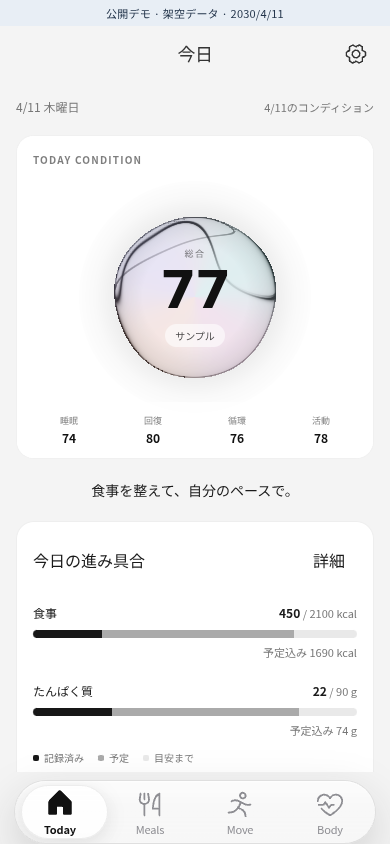
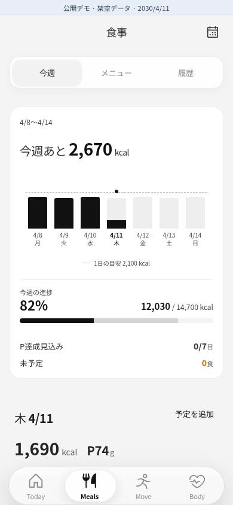

# Ayumu

食事・運動・コンディションの記録を、今日の行動につなげるアプリです。
このリポジトリでは、個人開発中のAyumuから取り出した画面と計算ロジックを、架空のデータで試せます。

<p>
  
  
</p>

## 解決したい課題

食事を記録し、運動や睡眠の数値を見ても、「今日は何を変えればいいか」は自分で考える必要があります。
記録を続けるほど情報が増え、振り返ること自体が負担になると、次の行動につながりません。

Ayumuでは、今日の状態と進み具合を先に見せ、その下に次の食事や運動の候補を並べています。
詳しい履歴は別の画面に残し、日々の確認では必要な情報から読める構成にしました。
続けるための手間を減らしながら、自分で行動を選べることを目指しています。

## 設計で工夫したこと

### 予定と実績を混ぜずに、見込みも出す

食事の予定と食べた記録は別々のデータです。
実績がある料理は実績だけを集計し、まだ記録していない料理は予定として計算します。
食べなかった記録がある場合は0として扱い、元の予定を足し直しません。

これにより、記録済みの量と、このまま予定どおり過ごした場合の見込みを同じ画面で確認できます。
週間グラフでは実績と予定を色で分け、量を修正した結果もその場で分かる表示にしました。
集計処理と、二重計上を防ぐテストは[meal-summary.ts](web/src/data/meal-summary.ts)と[model.spec.ts](tests/model.spec.ts)にあります。

### 食事・運動・体調を同じ操作で見られるようにする

Meals、Move、Bodyは、週間グラフから日付を選び、その日の詳細を見る構成を共有しています。
画面ごとに操作を覚え直さずに済むよう、カード、日付の選択、下部ナビゲーションを揃えました。
Todayには次の行動を置き、済んだ記録は折りたたんでいます。

コンディションの球体では、睡眠・回復・活動・循環を色と形に対応させました。
数値も併記し、欠けている値は低いスコアと区別します。
描画の実装は[condition-sphere](web/src/condition-sphere)にまとめています。

### 候補を選ぶルールをコードで確認できるようにする

運動の候補は、登録されたパターンや実績を使う決定的なロジックで作ります。
同じ入力なら同じ条件で候補を絞れるようにし、候補の検証もモデル側で行います。
公開版では架空のパターンを使い、AIやウェアラブルには接続しません。

## 試す

Node.js 24とnpmを使います。

```sh
npm ci
npm run build
npm run preview
```

表示されたローカルURLを開くと、スマートフォン向けの画面を操作できます。
PCで端末フレーム付きの表示を見る場合は、URLの末尾に`/?preview=1`を付けてください。
開発時は`npm run dev`でも起動できます。

最初にTodayの「食べた記録へ」から昼食を記録し、Mealsで実績と予定の内訳を確認すると、状態の変化が分かります。
料理の量の修正、MoveやBodyの日付の選択、設定でのライト・ダークの切り替えも試せます。

## 公開版の範囲

デモの日付は2030年4月11日で固定しています。
食事の1週間分の予定と、直近7日分のコンディションは、この公開版のために作った架空のデータです。
栄養値、目標値、スコア、運動の候補は動作確認用で、健康上の助言ではありません。

操作した記録は画面を開いている間だけ保持し、再読み込みか設定の「デモをリセット」で初期状態に戻ります。
表示テーマだけは、このデモ専用のキーでブラウザに保存します。
運用版のAPI、認証、同期、バックアップの読み込みは含めていません。
実際の食事・健康・健診の記録や、元リポジトリのGit履歴も含めていません。

## 実装と検証

主な技術はReact、TypeScript、Vite、Tailwind CSS、Three.jsです。
運用版から引き継いだ画面、モバイル操作部品、共有モデルと、公開用に置き換えた部分は[由来と変更範囲](docs/provenance.md)に記載しています。
モバイルの端末フレームやキーボードは既存のランタイムを利用しています。

```sh
npm run check:public
npm run build
npx playwright install chromium
npm test
```

公開範囲の静的検査、保護されたランタイム26ファイルのハッシュ照合、型検査、ビルド、PlaywrightのテストをCIで実行します。
テストでは、予定と実績の集計、記録・修正・リセット、運用版キャッシュの分離、外部への通信、主要画面を確認します。
[検証の条件と限界](docs/verification.md)も残しています。

今後は、Todayの情報量を実際の利用で確かめ、初回に読み込むJavaScriptの量を減らしたいと考えています。
この公開版だけで、健康改善の効果や本番の同期品質を示せるわけではありません。
